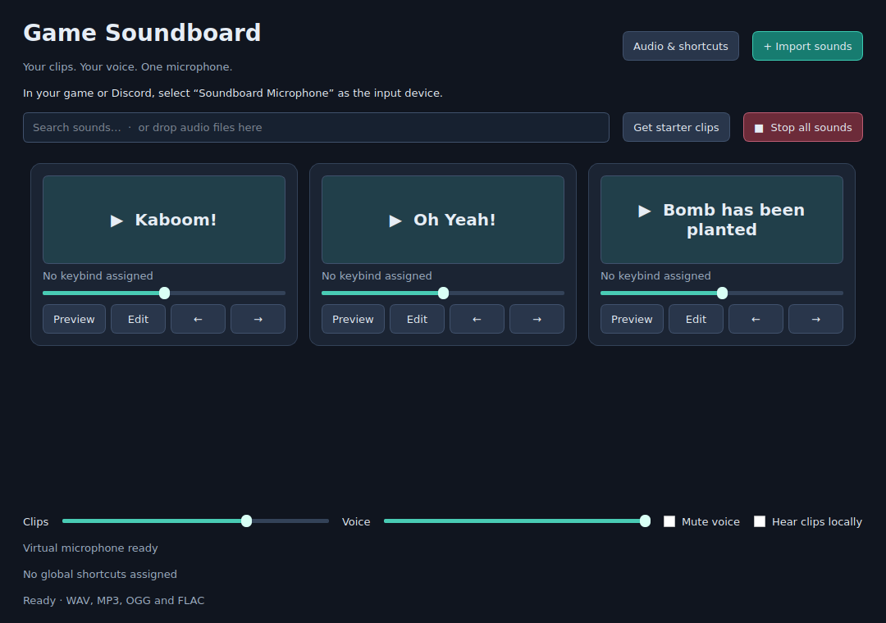

# Game Soundboard

A native Linux soundboard for Ubuntu/GNOME on Wayland. Trigger imported clips from a button grid or desktop-approved global keybinds, and combine them with your microphone for games and Discord.

## Install and launch

Requires Linux with PipeWire/PulseAudio compatibility, Python 3.12 or later, and a desktop implementing the XDG GlobalShortcuts portal. The initial target is Ubuntu with GNOME on Wayland.

```bash
sudo apt install git python3-venv pulseaudio-utils libxkbcommon0
git clone https://github.com/JustinBatchelor/game-soundboard.git
cd game-soundboard
./setup.sh
./run.sh
```

Setup creates an isolated `.venv` and installs a per-user **Game Soundboard** desktop launcher. You can subsequently launch it from your applications menu. Keep the checkout in place because the launcher points to it; rerun `scripts/install-desktop.py` with the virtual environment's Python if you move it.

The setup script uses `uv` when available, otherwise Python's venv/pip. FFmpeg is supplied by `imageio-ffmpeg` if a system FFmpeg is unavailable. The microphone service starts at login; the panel still launches manually.

For optional live microphone effects, install `rubberband-ladspa` (version **4.0 or newer** for Baby/Helium and Deep voice) and `swh-plugins` (Robot and Radio):

```bash
sudo apt install rubberband-ladspa swh-plugins
```

Older Ubuntu releases may ship Rubber Band 3.x without the live pitch plugin. Normal voice and clips work without these packages. Plugin binaries are not bundled in this repository.

## First use

1. Launch the app. On first launch it selects your current system microphone and output, then remembers their specific device names. Change them in **Audio & shortcuts**.
2. In your game or Discord, select **Soundboard Microphone** as the input. System defaults are never changed by this app. The status line shows the selected physical microphone and apps receiving the mixed input. If it says **No app is using Soundboard Microphone**, open the game's microphone test, click **Connect app**, and select that game. This moves only its active recording stream; select the device inside the game for future sessions.
3. Click a sound button to send it to voice chat. Enable **Hear clips locally** to also hear triggered clips in your headset.
4. **Preview** plays only to your selected headset, never into voice chat.
5. Use a card's **Edit** button, click the keybind field, and press your desired combination (for example **Ctrl+Alt+K** or **F8**). Use **Clear** to disable it. Save and approve the desktop's shortcut dialog. The card displays the desktop's accepted binding.
6. Record the Stop All keybind the same way in settings. Global shortcut playback is paused while either settings dialog is open, so recording keys does not trigger sounds. Stop All stops clips and previews; your voice remains connected. **Mute voice** mutes only the app's microphone route.

Different clips overlap. Repeating a clip restarts it. Minimize to keep shortcuts active. Closing the panel stops clips and shortcuts, but its separate audio service keeps the same virtual microphone, voice routing, mute, volume, and effect settings available. Reopening the panel does not recreate the input device. Game push-to-talk still applies, and noise suppression can filter clips. The app does not press a game's push-to-talk key.

When the virtual microphone is recreated, the app reconnects existing native recording streams that still explicitly request its device name but were moved to a fallback input. This recovery runs when rebuilding the audio graph; it does not override later manual input changes or move apps requesting another microphone. If a game has closed its capture stream entirely, reopen its microphone test or restart the game with the soundboard running.

## Persistent microphone service

`setup.sh` installs and enables `game-soundboard-audio.service` for your user. It keeps **Soundboard Microphone** available even while the panel is closed, including the selected physical microphone and live effect. Self-monitoring and mute also retain their saved states. No clip can play or global shortcut fire after the panel exits.

```bash
systemctl --user status game-soundboard-audio.service
journalctl --user -u game-soundboard-audio.service -n 50
```

To remove the always-available microphone, close the panel and run:

```bash
systemctl --user disable --now game-soundboard-audio.service
```

Opening the panel starts the service again. Re-enable login startup with `systemctl --user enable game-soundboard-audio.service`. A source checkout without an installed unit starts a detached daemon for its library instead; its log is `audio-service.log` in that library directory.

The first upgrade from panel-owned routing requires one device replacement. A game may need one restart during that handoff. Routine panel closes and reopens preserve the device afterward. A crashed service can now adopt its complete existing audio graph without replacing the microphone; it resumes in Normal voice. Explicit service stops, audio-server restarts, and logout can still interrupt capture; no service can retain a PipeWire device across the audio server itself being replaced.

## Live voice effects and microphone checks

The **AI Speech** tab generates typed **AI impressions** locally: choose a voice, type a line, Generate, then Preview privately or Play through Soundboard Microphone. Save favorites as ordinary sound buttons with keybinds. Generation never plays automatically and releases GPU memory after each job. See [AI Speech setup and behavior](docs/AI-SPEECH.md). Live celebrity conversion controls have been replaced; normal microphone and generic effects remain available. Previous RVC models and service interfaces are retained for rollback; their [historical documentation](docs/AI-VOICES.md) describes the old workflow.

Choose **Normal**, **Baby / Helium** (+8 semitones), **Deep voice** (−6 semitones), **Robot**, or **Radio** from the panel. These are local microphone effects; clip playback is unchanged. Normal is the default. Switching presets preserves the public microphone device and its connected applications. Missing or failed effects suspend the microphone route and display an error while keeping clips available; choose Normal to restore unprocessed voice.

**Hear my voice** sends the processed microphone to the chosen headphones for testing. It starts off and is separate from **Hear clips locally**. Use headphones to avoid feedback; processing and monitoring add delay. Voice volume and mute affect both the game feed and self-monitoring, without modifying the physical microphone's system settings. Stop All stops clips and previews while voice continues.

If teammates cannot hear you, check the physical headset mute button, **Mute voice**, and the microphone selection under **Audio & shortcuts**. Enable **Hear my voice** briefly to check the microphone path. Then verify the game appears under **Receiving apps**, and check its push-to-talk, input gain, and voice-processing settings. Hearing Preview locally does not mean the game receives it: Preview is intentionally headphones-only. A connected stream confirms routing, not that the game is transmitting over the network.

Upgrading from the first version: virtual devices previously appeared with the truncated name **Soundboard**. Reselect **Soundboard Microphone** in CS2; restart the game with the soundboard running if its device list is stale. CS2's **Hear My Own Voice** test is separate from this app's **Hear my voice** checkbox.

The desktop owns global binding decisions. Saving a changed key creates a fresh desktop registration so an earlier approved key cannot silently replace the new preference. Approve the new binding if your desktop prompts. Unchanged registrations survive relaunch; sound IDs remain unchanged. **Configure approved shortcuts in desktop** opens the desktop’s own editor. Clearing a sound's keybind removes it from the active session. Duplicate preferences within the app are rejected; desktop conflicts/denials appear in the status area. Shortcuts work only while the app is running in your logged-in desktop session.

## Starter recordings

First launch imports missing starters; **Get starter clips** retries failed downloads. Successful starter imports are recorded permanently, so removing a starter does not restore it on every launch. Clips are stored at 50% individual volume (master volume defaults to 70%), with no keybind assigned.

- [COD Zombies — Kaboom!](https://www.youtube.com/watch?v=UO9JSE3aRtw)
- [Kool-Aid Man — Oh Yeah!](https://www.myinstants.com/en/instant/oh-yeah-kool-aid-man-35548/)
- [CSGO/CS2 — Bomb has been planted](https://www.myinstants.com/en/instant/bomb-has-been-planted-csgo-cs2-75763/)
- [CSGO/CS2 — Bomb has been defused](https://www.myinstants.com/en/instant/cs-go-bomb-has-been-defused-95024/)
- [SpongeBob — Oh brother, this guy stinks!](https://www.myinstants.com/en/instant/oh-brother-this-guy-stinks/)
- [Fahh — meme sound effect](https://www.youtube.com/watch?v=VP6eZu3SAak)
- [Vine Boom](https://www.myinstants.com/en/instant/vine-boom-sound-70972/)
- [Bruh](https://www.myinstants.com/en/instant/bruh/)
- [SpongeBob Fail](https://www.myinstants.com/en/instant/spongebob-fail-11236/)
- [The Saxophones Getting Louder](https://www.myinstants.com/en/instant/the-saxophones-getting-louder-61232/)
- [This is Rocket League!](https://www.myinstants.com/en/instant/this-is-rocket-league-94006/)

These third-party recordings are downloaded into your local library, not included in this repository. Kaboom uses the linked Black Ops video; yt-dlp retrieves its audio. Original source and download URLs are retained in each record. Audio is not bundled in source distributions. Import your preferred recording if an upload differs from the version you want. Downloads are bounded and time out; failures do not prevent local imports or playback. All imported audio works offline afterward.

## Library and architecture

Data lives in `$XDG_DATA_HOME/game-soundboard` (normally `~/.local/share/game-soundboard`): a versioned atomic JSON manifest, managed originals, and decoded 48 kHz stereo PCM WAV cache. Set `SOUNDBOARD_DATA_DIR` for an isolated test library. Back up the entire directory. Removing a sound deletes its managed copies, never the source file you imported.

- `library`: asynchronous preparation, atomic persistence and starter history.
- `playback`: reusable Qt sound effects; shared click/shortcut playback path.
- `audio_service`: per-library background graph owner, with a private Unix socket for panel controls and three-second health checks. The service reads settings from the atomic manifest; only the GUI writes the library.
- `routing`: PipeWire/PulseAudio module creation, recovery, and capture connection management.
- `voice_effects`: microphone-only LADSPA presets, using Rubber Band's live pitch shifter and SWH filters.
- `shortcuts`: XDG GlobalShortcuts portal in an asyncio worker, delivering Qt signals.
- `speech`, `speech_worker`, `speech_ui`: cancellable, panel-owned offline generation, temporary clip playback, and saving to the normal library.
- `ui`: searchable grid, import workers, controls and device settings.

The D-Bus transport uses `dbus-next` because PySide6 does not expose the custom-type registration needed for the portal's `a(sa{sv})` messages. It registers the installed desktop ID with the host portal Registry. The audio service starts in the user session. Its control socket is restricted to the current user; there is no TCP listener, raw keyboard hook, or root input access.

```text
Clips -> Clip bus -----------------> Voice mix -> Soundboard Microphone -> Game/Discord
           |                           ^
           v                           |
       Headphones    Mic -> Effect -> Voice bus
                                       |
                                       +-> Headphones (optional Hear my voice)
Preview -> Headphones only
```

Owned module names include a hash of the library path. Panel exit leaves them running. Explicitly stopping the audio service removes them; a service restart reconciles leftovers after a crash. Recovery touches only that library's modules. Unplugged devices are not silently replaced; their routes suspend until the same named device returns. Global shortcut session loss is reported and can be reconnected from settings. An unsupported or malformed manifest is left untouched and produces an error.

## Verification

```bash
.venv/bin/python -m pytest -q
PYTHONPATH=src QT_QPA_PLATFORM=offscreen .venv/bin/python scripts/probe-live.py
PYTHONPATH=src QT_QPA_PLATFORM=offscreen .venv/bin/python scripts/test-live-audio.py
PYTHONPATH=src .venv/bin/python scripts/test-reconnect-live.py
PYTHONPATH=src QT_QPA_PLATFORM=offscreen .venv/bin/python scripts/test-single-instance.py
./run.sh --screenshot /tmp/soundboard.png
```

Live probes require access to your real desktop session, PipeWire, and the installed launcher. The audio test uses temporary null sinks and synthetic tones, never the physical microphone or headphones. Run live probes outside a restrictive sandbox. `parec` from `pulseaudio-utils` is needed for the audio test.

The restart recovery test also uses `pw-record` from `pipewire-bin`, restricted to silent synthetic sources, and checks that explicit device requests recover without changing system defaults or fighting later manual input changes.

The remaining user acceptance checks are approving chosen keybinds, triggering them while a fullscreen game has focus, selecting the virtual input in that game, checking perceived volume, and measuring end-to-end trigger latency under gaming load. The under-100-ms figure is a target, not a guarantee. Native Linux games and other applications may handle device changes and voice processing differently.

### Validation results

- Automated tests cover key capture and conversion, binding preservation, duplicate detection, playback suppression while editing, library imports and persistence, routing recovery, effect failure isolation, capture-stream identity checks, and shortcut session handling.
- Live portal registration and session creation succeeded. The test did not assign/grab any keyboard combination.
- Live synthetic audio verified overlapping clips plus voice in the virtual microphone, preview isolation, monitoring without voice feedback, microphone mute, and Stop All preserving voice.
- Live spectral tests verified both pitch shifts, robot modulation, radio filtering, optional voice monitoring, unchanged clips, and a stable virtual microphone across preset changes.
- Warm trigger-to-capture measured about 42 ms in the synthetic test on the current desktop. Fullscreen-game keybind timing and network/voice-chat processing remain unmeasured.
- Live UI, device discovery, search, and single-instance activation passed. Two panel closes/reopens retained the exact same microphone device ID and native capture stream. Duplicate services do not disturb the owner; explicit service shutdown cleans up its modules.
- On the development desktop, the user confirmed CS2's microphone test played both their voice and clips after reselecting **Soundboard Microphone** (2026-11-22). Live signal measurements also confirmed the physical microphone reached the virtual input at matching levels.
- All three starter recordings downloaded and decoded. Local speech recognition confirmed “Oh yeah” and “Bomb has been planted.” Kaboom uses audio from the linked YouTube video (UO9JSE3aRtw).


